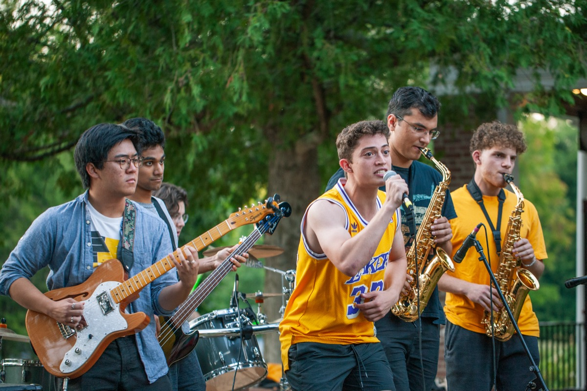
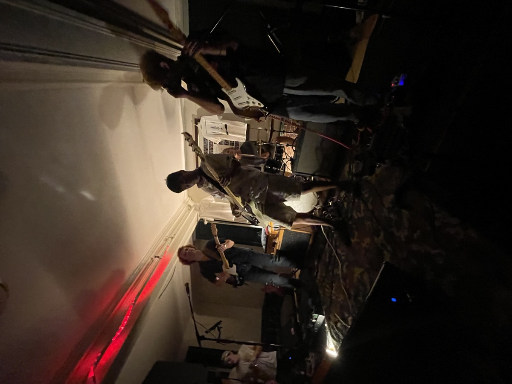
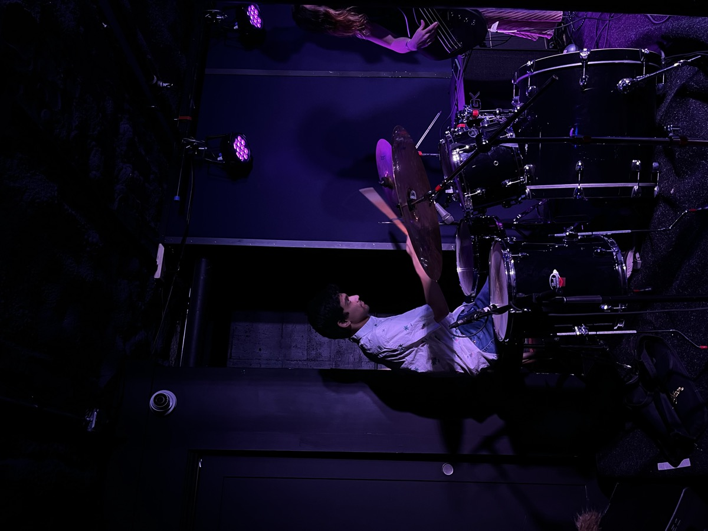

::: {style="width: 50%; margin: 0 auto;"}

::: {.grid}

::: {.g-col-12}
{fig-alt="Band performing outdoors"}
:::

::: {.g-col-12 .g-col-md-6}
{fig-alt="Band playing in a dimly lit house show"}
:::

::: {.g-col-12 .g-col-md-6}
{fig-alt="Drummer performing on stage under purple lights"}
:::

:::

:::

Music is just as important to me as political science is. I studied music alongside government at Dartmouth, and played in eight different bands. Apart from being a proud Coast Jazz Orchestra alum, I've played bass and drums in pop, rock, country, funk, and jam bands. Please reach out if you're in the Boston area and interested in collaborating!

## Listen

My friend Adam and I are close musical collaborators. Though we've not been able to work on music together recently, here's a selection of some songs we've written together.

<iframe width="100%" height="450" scrolling="no" frameborder="no" allow="autoplay"
  src="https://w.soundcloud.com/player/?url=https%3A//soundcloud.com/adamelbie/sets/tuesdays&color=%23ff5500&auto_play=false&show_teaser=true&visual=true"></iframe>
